<p align="center">
  
</p>

<h1 align="center">Cubi</h1>

<p align="center"><b>住在 MacBook 瀏海的 Claude Code 小機器人 Cubiiii。</b></p>

<p align="center">
  <a href="https://github.com/jc33654/cubi/releases"></a>
  
  
  
  <a href="LICENSE"></a>
</p>

<p align="center">
  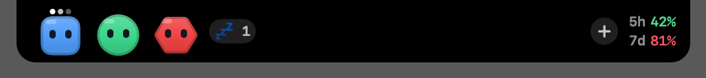
</p>

每開一個 Claude Code session，瀏海旁就多一隻 Cubiiiii。它在想事情、在跑工具、在等你、累了、睡了，一眼看得出來。要你批准指令或回答問題時，卡片直接從瀏海滑下來，按一下就好，不用去翻是哪個終端分頁在叫。

一個 app 加一個 hook relay。沒有雲端、沒有帳號、沒有遙測：資料只在這台機器的 unix socket 上走。

## 為什麼

同時開三、四個 Claude Code，每個都在不同的終端分頁裡。誰在等我批准？誰已經做完了？哪個 context 快爆了？切來切去很煩，漏掉一個「要不要允許」更煩。

瀏海平常就是一塊黑，剛好拿來住人。住進去的叫 Cubiiii：i 的數量沒有規定，看心情。

## 認識 Cubiiiiii

一隻 Cubiii 就是一個 session，各自一種顏色（右鍵可以換形狀、換顏色，它會記得）。表情就是狀態：

<table>
  <tr>
    <td align="center">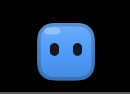<br><b>idle</b><br><sub>等你說話</sub></td>
    <td align="center">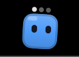<br><b>thinking</b><br><sub>頭頂三點</sub></td>
    <td align="center">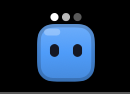<br><b>working</b><br><sub>在跑工具</sub></td>
    <td align="center">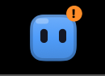<br><b>waiting</b><br><sub>跳著等你批准或回答</sub></td>
  </tr>
  <tr>
    <td align="center">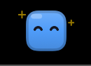<br><b>happy</b><br><sub>做完了，開心 1.5 秒</sub></td>
    <td align="center">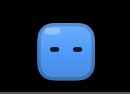<br><b>error</b><br><sub>抖一下</sub></td>
    <td align="center">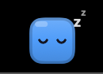<br><b>sleeping</b><br><sub>10 分鐘沒動靜（可調），點一下叫醒</sub></td>
    <td align="center">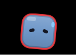<br><b>tired</b><br><sub>context ≥ 80%，≥ 90% 紅邊脈動</sub></td>
  </tr>
</table>

眼睛會跟著你的滑鼠轉。

## 它會做的事

- 🛎️ **審批直接在瀏海上按** — Claude Code 要跑指令、改檔案，卡片滑下來：**拒絕／在終端處理／總是允許／允許**。你在終端先答了，卡片自己收回。
- ❓ **AskUserQuestion 也在這裡答** — 每題一組按鈕，多選用勾選；想回終端答也行。
- 🔍 **看它改了什麼** — 清單上的 `+N −M` 徽章點開就是那次 Edit / Write 的 diff。
- 📊 **plan 用量** — 右翼顯示 5h / 7d 用掉的百分比，跨 session 合併，快到上限會變色。
- 🪫 **context 快滿會露出疲憊表情** — 不用自己去看 status line。
- 🧭 **點 Cubiii 跳到它的終端** — Terminal.app、Ghostty 都認得分頁。
- ➕ **從瀏海開新 session** — 選專案、填第一句話、要不要接續上次，⌘↩ 就開在你的終端裡。
- 🌙 **晚安區** — 放著不管的 session 自動進晚安區不佔位子；也可以手動「去睡覺」或「放生」。
- 🎨 **換形狀、換顏色、拖著排順序** — 全部記得住，Cubi 重啟、session 回來都還在。
- 🪟 **拖出來變浮動視窗** — 沒瀏海的螢幕、外接螢幕都能用，拖回頂端就回去。
- 🔌 **其他 agent 也能接** — 一份 manifest 就能讓別的 agent 的 session 出現在島上（目前只能監看）。
- 🧰 **工具插件** — 一個 HTML 面板加一張白名單指令表就是一個插件，從選單打開；還能在每個 session 的資訊窗掛一塊自己的內容。
- 🗓️ **工時進行事曆** — 內建的 sprint 插件把 session 有在做的時段寫進你選的行事曆、對到 Jira 工單，sprint 結束時回顧頁有估點 vs 實際、burndown 與投入時數。

<p align="center">
  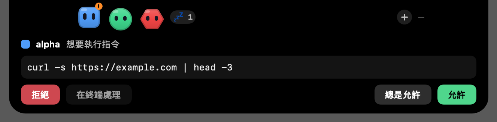<br>
  <sub>要批准的時候，整張卡片就在瀏海下面。</sub>
</p>

<p align="center">
  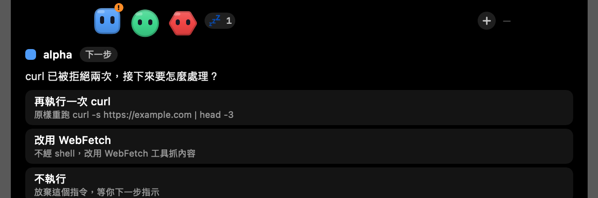<br>
  <sub>Claude 問你問題，Cubiiii 把選項變成按鈕。</sub>
</p>

<p align="center">
  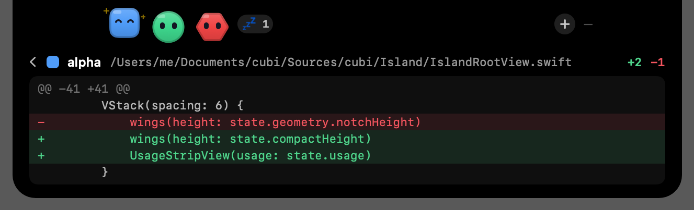<br>
  <sub>它剛改了什麼，點徽章就看得到。</sub>
</p>

<p align="center">
  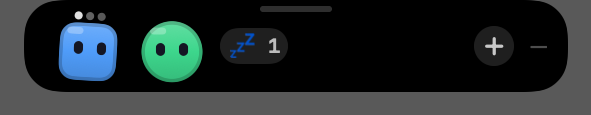<br>
  <sub>拖離瀏海就變成浮動視窗，Cubiiiii 哪個螢幕都能住。</sub>
</p>

## 安裝

### 現成的 app

```
curl -fsSL https://raw.githubusercontent.com/jc33654/cubi/main/scripts/install.sh | bash
```

不用 Xcode、不用憑證。腳本會從 GitHub Releases 抓最新的 `Cubi.zip`，做完整性校驗（sha256）與來源驗證（簽章必須是 Cubi 的 `cubi-dev` 憑證，憑證 hash 寫在腳本裡），裝到 `~/Applications/Cubi.app`，拿掉 quarantine 後打開。`CUBI_VERSION=v0.1.0` 可以指定版本。

**你在信任什麼**：Cubi 沒有 Apple 公證（不買 Developer ID 的代價），所以 macOS 的 Gatekeeper 會擋它。腳本替你做的事是：先用 `codesign -R` 確認這個包真的是用 Cubi 的憑證簽的，確認過才拿掉 quarantine。不想跑 `curl | bash` 的話，自己來：

1. 到 [Releases](https://github.com/jc33654/cubi/releases) 下載 `Cubi.zip`，解開拖到 `~/Applications`。
2. 第一次打開會被擋：對 app 按右鍵 → 打開，或到「系統設定 → 隱私與安全性」按「強制打開」。

每一版都用同一張自簽憑證簽，更新後 Automation 授權不用重做（推論，依 TCC 以 designated requirement 認 app 的規則）。

### 從原始碼建置

需要 macOS 15 以上（沒瀏海的螢幕也行，會在頂端置中浮一條小 pill）、Xcode Command Line Tools（`xcode-select --install`，**不需要 Xcode.app**）、Claude Code 2.1.312 以上。

```
git clone https://github.com/jc33654/cubi.git
cd cubi
make cert      # 檢查簽章憑證，第一次會告訴你怎麼建
make icon      # 由程式自己畫出 app icon（可略過，略過就沒有 icon）
make install   # 建置、打包、簽章、安裝到 ~/Applications/Cubi.app
open ~/Applications/Cubi.app
```

憑證怎麼建、其他 make 目標、發版流程都在 [docs/development.md](docs/development.md)。

### 第一次執行

1. 啟動後 menubar 會有一個圖示，但 menubar 太滿時 macOS 會把它藏到瀏海後面。**所有選單在島上按右鍵**也有：顯示／收起、保持顯示、系統通知、音效、登入時啟動、設定…、結束。
2. hooks 還沒裝時會自動打開設定視窗。按 **安裝…**，看完 diff 再按 **寫入**。寫入前會先備份到 `~/.claude/backups/cubi/`。
3. **重開已開著的 Claude Code**：hooks 在 session 啟動時讀取，中途改 settings 不生效。status line 則是熱更新。
4. 第一次點機器人跳回終端時，macOS 會跳 **Automation** 授權（控制 Terminal / Ghostty），按允許。
5. 系統通知預設關；在設定頁開啟時 macOS 會問通知授權。

## 操作一覽

| 動作 | 效果 |
|---|---|
| 滑鼠靠近瀏海 | 島滑出來成 compact（機器人一排 + 用量） |
| 點島 | expanded：session 清單（名稱、context %、最近一次編輯的 +N −M）、用量列。高度隨內容長，最多到螢幕七成 |
| 點清單的一列 | 右邊打開這個 session 的資訊：專案、模型／effort／版本、開始時間、使用時間（Claude Code 回報的時長加上之後經過的時間，每秒走）、回合與工具呼叫數、花費、變更行數、context、終端。按「跳到終端」切到它的分頁，✕ 關閉。底下是有掛 session hook 的插件各一塊（例如 sprint：綁的工單與剩餘時數、每列尾端 ✕ 解除那張、今日時數、計時中，按鈕「綁單號…」「▶／⏸ 計時」「同步 Jira」「開面板」） |
| 點機器人 | 跳到那個 session 的終端分頁（Terminal.app 用 tty；Ghostty 用分頁標題比對 session 名字，名字先看 Claude Code 自己的登錄檔 `~/.claude/sessions/`，改名立刻生效；標題比不到才看 cwd，而且只在只有一個分頁在那個目錄時才跳，不然寧可不跳；其他 app 只切到 app）；hooks 環境沒有 `TERM_PROGRAM`／tty 的 session 只能用名稱／cwd 猜：先問 Ghostty 再問 Terminal.app，都沒中就不動。沉睡中的機器人點一下會醒 |
| 有審批 | 島自動打開卡片：**拒絕 / 在終端處理 / 總是允許 / 允許**。「總是允許」會把 Claude Code 自己建議的規則寫進 session 與 `settings.local.json` |
| 有 AskUserQuestion | 每題一組選項按鈕；多選用勾選；也可「在終端回答」 |
| 終端自己答了或按 Esc | 卡片自動收回 |
| session 的 `+N −M` 徽章 | 點開看那次 Edit / Write 的 diff |
| 右鍵機器人（翼上或清單列） | 換形狀（方塊／圓形／三角／六角）與顏色（自動或十色之一），記在這個 session 上：它結束再回來、Cubi 重啟都還在（最多記 200 個 session，超過才丟掉不在線的最舊那些） |
| 在翼上拖一隻機器人 | 水平拖越過其他隻放開就換順序，展開的清單同一順序；順序會記住，排過的 session 回來會歸位，新的 session 接在最後（靠瀏海那側）。拖機器人不會把島拖成浮動視窗 |
| 把島拖離瀏海 | 變成浮動視窗，可以拖到任何螢幕（外接螢幕也行）；卡片會在浮動視窗裡展開，瀏海那邊不再顯示。拖回瀏海頂端放開就回去；右鍵選單「浮動視窗」也能切換 |
| 右鍵機器人 → 去睡覺／起床上班／放生 | **工作中**的 session 在瀏海旁那排；**晚安**的不排，只留一個「💤 N」膠囊，展開清單才分區。沉睡 12 小時自動進晚安區（預設；設定頁可調 1–24 小時或從不。有動靜就回來）；手動「去睡覺」要等你再送訊息、或它要問你才回來。「放生」整個消失，同樣在你再送訊息、它要問你、或 session 重新開始時回來（自動壓縮觸發的重新開始不算）。兩者都記得住 Cubi 重啟 |
| 右鍵 → 保持顯示 | 島不收回，休息時停在 compact；滑入就直接展開，設定頁可關掉（關了滑入只停在 compact，點一下才展開） |
| 用量旁的 ＋（島一滑入就能按，不用展開）、右鍵 → 開新 session…（⌘N） | 對話框：選專案目錄（Cubi 開過的 + Claude Code 記錄過的 `~/.claude.json` projects，或「瀏覽…」）、選填第一句話（一開就送出）、「接續上次對話」（`claude --continue`）、終端（自動＝Ghostty 有裝就 Ghostty，否則 Terminal.app）。⌘↩ 開始。Ghostty 開在最前面視窗的新分頁、Terminal.app 開新視窗，指令當第一行輸入打進去，所以 PATH、shell 都是你自己的 |
| 右鍵機器人 → 在這個專案再開一個…／在新分頁接續這個 session；資訊面板「再開一個」 | 用那個 session 的專案目錄與終端。「接續這個 session」不開對話框，直接 `claude --resume <這個 session 的 id>`（不是 `--continue`：同目錄有兩個 session 時才不會接錯）。終端開不了（Automation 沒允許、Ghostty 太舊）會跳一個警告；Ghostty 失敗會改試 Terminal.app |

音效用 macOS 內建系統音，設定頁可關。

## 設定頁

- **Claude Code**：hooks 與 status line 狀態、安裝／解除、舊 hook 退役選項
- **顯示**：保持顯示、滑入就展開、機器人大小（小／預設／大）、音效、系統通知、登入時啟動
- **睡眠**：多久沒動靜進入沉睡（5–60 分鐘，預設 10）、沉睡多久自動進晚安區（1–24 小時或從不，預設 12）
- **行事曆**：允許存取、選要寫入的行事曆（給有 tick hook 的插件用；只寫入、標「空閒」）
- **範圍**：忽略哪些目錄開頭的 session（一行一個，可用 `~`）
- **插件**：Agents（各 agent plugin 開關、安裝、API key）與工具（開關、開啟面板）；「重新載入」掃 plugins 目錄

## 它動了哪些東西

| 位置 | 內容 |
|---|---|
| `~/.claude/settings.json` | 12 個 hook 事件各一組 `cubi-hook` 指令，加 `PreToolUse` 的 `AskUserQuestion` matcher；`statusLine` 包一層：`cubi-hook … statusline --then '<原指令>'`，原指令照常執行、輸出不變 |
| `~/.claude/backups/cubi/settings.json.bak-<時間>` | 每次寫入前的備份 |
| `~/.cubi/bin/cubi-hook` | relay 本體，app 啟動時從 bundle 複製、內容不同就更新；路徑刻意無空白 |
| `~/.cubi/agents/claude-code.json` | 串接前的 `statusLine`，解除安裝時還原 |
| `~/Library/Application Support/cubi/cubi.sock` | app 的 unix socket（0600，只收同 UID） |
| `~/Library/Application Support/cubi/plugins/` | 插件；`cubi/sprint/` 是 sprint 插件自己的資料 |
| 你選的行事曆 | 有 tick hook 的插件要求時才寫事件（備註最後一行 `由 Cubi 記錄 · …` 是去重記號） |
| `~/Library/Logs/cubi.log` | 事件與錯誤 log，出問題先看這裡 |

你自己原有的 hooks 不會被動；安裝器只追加自己的條目，解除時只刪自己的。設定頁可勾選「同時移除舊的桌面通知 hook」。

## 怎麼運作

- **relay** `cubi-hook` 是 Claude Code 每個 hook 事件跑的小程式：stdin 讀 payload，送進 unix socket，等 app 回覆再寫回 stdout。只 import Darwin，冷啟動個位數毫秒。
- **app** 收事件、更新每個 session 的狀態機、畫機器人。審批這類 blocking 事件最多等 115 秒；app 沒開或當掉，Claude Code 自動退回終端自己問，什麼都不會卡住。
- 島的狀態：`hidden → compact → expanded`。瀏海是物理的，所以島永遠以瀏海為中心留白，機器人在左翼、用量在右翼。沒瀏海的螢幕會在頂端置中浮一條小 pill 當瀏海用。
- 零第三方依賴：AppKit + SwiftUI，SwiftPM，不用 Xcode.app。
- 設計與決策寫在 [docs/plan.md](docs/plan.md)，relay 協定與欄位在 [docs/protocol.md](docs/protocol.md)，進度在 [docs/status.md](docs/status.md)。

## 插件

都放在 `~/Library/Application Support/cubi/plugins/<id>/manifest.json`，規格在 [docs/advanced.md](docs/advanced.md)（進階操作）。

**Agent plugin**：Claude Code 是內建的。其他 agent 可以用一份 manifest 接進來，在設定頁開啟；範例在 `docs/plugins/example-agent/`。目前 manifest plugin **只能監看**（session、工具開始／結束、結束），它的審批不會出現在島上，會落回那個 agent 自己的提示。要做審批得寫程式碼 plugin（實作 `AgentPlugin` 協定）。

**工具插件**（`"kind": "tool"`）：一個 HTML 面板加一張指令表。面板的 JavaScript 只能呼叫表裡的指令，每個參數都有型別（名稱／值／選項／長文走 stdin），不經 shell。選單與設定頁各有入口。再掛兩個選填的 hook 就能進島：`session`（資訊窗選到 session 時執行，回幾列文字、連結與按鈕）與 `tick`（定時執行，回要寫進行事曆的事件，由 Cubi 去寫）。範例在 `docs/plugins/example-tool/`（最小）與 `docs/plugins/sprint/`（完整：Jira 工單、估點／實際、時數、回顧圖表）。

## 解除安裝

1. 設定頁按 **解除安裝…**（或 `cubi --uninstall-hooks`）：移除 Cubi 的 hook 條目、還原 `statusLine`。
2. 「登入時啟動」有開的話先在設定頁關掉。
3. 結束 app，刪 `~/Applications/Cubi.app`、`~/.cubi/`、`~/Library/Application Support/cubi/`、`~/Library/Logs/cubi.log`。
4. 偏好設定：`defaults delete cc.dotdot.cubi`。
5. 有存過 plugin 的 API key 的話，Keychain Access 搜尋 service `cc.dotdot.cubi` 刪掉。
6. `~/.claude/backups/cubi/` 是 settings.json 的歷史備份，可留。

## 開發與發版

改程式、make 目標、命令列、憑證、CI 與發版流程：[docs/development.md](docs/development.md)。

## 致謝

協定與做法借自 [Coucou](https://github.com/louis-cfm/coucou)（MIT）。Cubi 的程式碼、Cubiiii 與圖示都是自己畫的。

## 授權

MIT，見 [LICENSE](LICENSE)。
